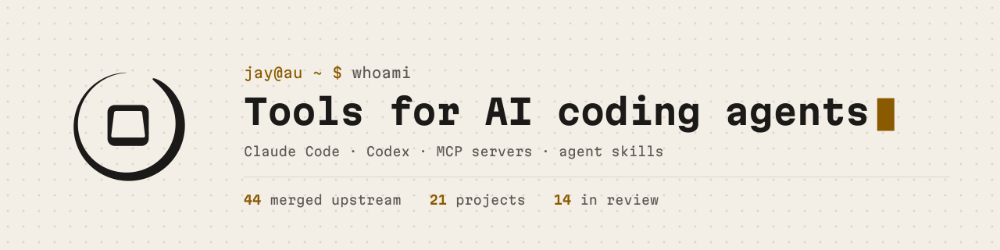
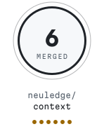
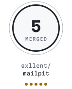
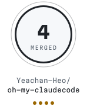
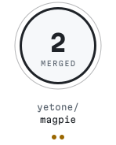
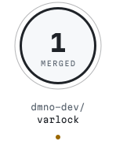

<!-- generated:banner -->
<picture><source media="(prefers-color-scheme: dark)" srcset="generated/banner-dark.svg"></picture>
<!-- /generated:banner -->

I'm Jeremy, a developer in Australia. I write mostly Go and Rust, and I'm a little obsessed with making software fast and lean.

My interests wander: tools for AI coding agents, running AI locally, IT admin tools, peer-to-peer networking, security and bug hunting. Most of my public work so far is fixes in other people's projects, listed below. The tools I build myself are released under [Sigilet Labs](https://github.com/sigiletlabs).

By day I look after systems and infrastructure, and manage open source projects, for a not-for-profit. Everything here is personal work.

If you work on similar things, I'd like to hear from you. Open an issue on any of my repos and say hello.

## Start here

- [soc-thief](https://github.com/sigiletlabs/soc-thief): sleep through the night while it reads your Wazuh alerts. You get one Discord message in the morning, and a page only when something looks like a breach. An AI model gives advice but can't hide an alert. It runs on your own host, reads Wazuh with a read-only account, and sends nothing to a hosted model unless you opt in.

  

- [ai-quota-meter](https://github.com/sigiletlabs/ai-quota-meter): shows your remaining Claude Code quota on the status line, using Anthropic's own numbers, and switches on Codex's built-in quota display. A single static binary with no network access.

  

## Merged upstream

Fixes merged into other people's projects. One dot per merged pull request.

<!-- generated:stamps -->
<a href="https://github.com/neuledge/context/pulls?q=is%3Apr%20author%3AJayOfTheKeyboard%20is%3Amerged"><picture><source media="(prefers-color-scheme: dark)" srcset="generated/stamps/neuledge-context-dark.svg"></picture></a>
<a href="https://github.com/morluto/rea/pulls?q=is%3Apr%20author%3AJayOfTheKeyboard%20is%3Amerged"><picture><source media="(prefers-color-scheme: dark)" srcset="generated/stamps/morluto-rea-dark.svg"></picture></a>
<a href="https://github.com/axllent/mailpit/pulls?q=is%3Apr%20author%3AJayOfTheKeyboard%20is%3Amerged"><picture><source media="(prefers-color-scheme: dark)" srcset="generated/stamps/axllent-mailpit-dark.svg"></picture></a>
<a href="https://github.com/Yeachan-Heo/oh-my-claudecode/pulls?q=is%3Apr%20author%3AJayOfTheKeyboard%20is%3Amerged"><picture><source media="(prefers-color-scheme: dark)" srcset="generated/stamps/yeachan-heo-oh-my-claudecode-dark.svg"></picture></a>
<a href="https://github.com/freescout-help-desk/freescout/pulls?q=is%3Apr%20author%3AJayOfTheKeyboard%20is%3Amerged"><picture><source media="(prefers-color-scheme: dark)" srcset="generated/stamps/freescout-help-desk-freescout-dark.svg"></picture></a>
<a href="https://github.com/yetone/magpie/pulls?q=is%3Apr%20author%3AJayOfTheKeyboard%20is%3Amerged"><picture><source media="(prefers-color-scheme: dark)" srcset="generated/stamps/yetone-magpie-dark.svg"></picture></a>
<a href="https://github.com/frida/frida-tools/pulls?q=is%3Apr%20author%3AJayOfTheKeyboard%20is%3Amerged"><picture><source media="(prefers-color-scheme: dark)" srcset="generated/stamps/frida-frida-tools-dark.svg"></picture></a>
<a href="https://github.com/88250/lute/pulls?q=is%3Apr%20author%3AJayOfTheKeyboard%20is%3Amerged"><picture><source media="(prefers-color-scheme: dark)" srcset="generated/stamps/88250-lute-dark.svg"></picture></a>
<a href="https://github.com/getkin/kin-openapi/pulls?q=is%3Apr%20author%3AJayOfTheKeyboard%20is%3Amerged"><picture><source media="(prefers-color-scheme: dark)" srcset="generated/stamps/getkin-kin-openapi-dark.svg"></picture></a>
<a href="https://github.com/google/osv-scanner/pulls?q=is%3Apr%20author%3AJayOfTheKeyboard%20is%3Amerged"><picture><source media="(prefers-color-scheme: dark)" srcset="generated/stamps/google-osv-scanner-dark.svg"></picture></a>
<a href="https://github.com/zvec-ai/zvec-grep/pulls?q=is%3Apr%20author%3AJayOfTheKeyboard%20is%3Amerged"><picture><source media="(prefers-color-scheme: dark)" srcset="generated/stamps/zvec-ai-zvec-grep-dark.svg"></picture></a>
<a href="https://github.com/jgm/pandoc/pulls?q=is%3Apr%20author%3AJayOfTheKeyboard%20is%3Amerged"><picture><source media="(prefers-color-scheme: dark)" srcset="generated/stamps/jgm-pandoc-dark.svg"></picture></a>
<a href="https://github.com/holepunchto/dht-rpc/pulls?q=is%3Apr%20author%3AJayOfTheKeyboard%20is%3Amerged"><picture><source media="(prefers-color-scheme: dark)" srcset="generated/stamps/holepunchto-dht-rpc-dark.svg"></picture></a>
<a href="https://github.com/ublue-os/ucore/pulls?q=is%3Apr%20author%3AJayOfTheKeyboard%20is%3Amerged"><picture><source media="(prefers-color-scheme: dark)" srcset="generated/stamps/ublue-os-ucore-dark.svg"></picture></a>
<a href="https://github.com/curl/curl/pulls?q=is%3Apr%20author%3AJayOfTheKeyboard%20is%3Aclosed"><picture><source media="(prefers-color-scheme: dark)" srcset="generated/stamps/curl-curl-dark.svg"></picture></a>
<a href="https://github.com/vectorize-io/hindsight/pulls?q=is%3Apr%20author%3AJayOfTheKeyboard%20is%3Amerged"><picture><source media="(prefers-color-scheme: dark)" srcset="generated/stamps/vectorize-io-hindsight-dark.svg"></picture></a>
<a href="https://github.com/dmno-dev/varlock/pulls?q=is%3Apr%20author%3AJayOfTheKeyboard%20is%3Amerged"><picture><source media="(prefers-color-scheme: dark)" srcset="generated/stamps/dmno-dev-varlock-dark.svg"></picture></a>
<a href="https://github.com/microsoft/SkillOpt/pulls?q=is%3Apr%20author%3AJayOfTheKeyboard%20is%3Amerged"><picture><source media="(prefers-color-scheme: dark)" srcset="generated/stamps/microsoft-skillopt-dark.svg"></picture></a>
<a href="https://github.com/NVIDIA/SkillEvaluator/pulls?q=is%3Apr%20author%3AJayOfTheKeyboard%20is%3Amerged"><picture><source media="(prefers-color-scheme: dark)" srcset="generated/stamps/nvidia-skillevaluator-dark.svg"></picture></a>
<a href="https://github.com/microsoft/conductor/pulls?q=is%3Apr%20author%3AJayOfTheKeyboard%20is%3Amerged"><picture><source media="(prefers-color-scheme: dark)" srcset="generated/stamps/microsoft-conductor-dark.svg"></picture></a>
<a href="https://github.com/volcengine/OpenViking/pulls?q=is%3Apr%20author%3AJayOfTheKeyboard%20is%3Amerged"><picture><source media="(prefers-color-scheme: dark)" srcset="generated/stamps/volcengine-openviking-dark.svg"></picture></a>
<!-- /generated:stamps -->

Every merged pull request, one line each

- [neuledge/context#125](https://github.com/neuledge/context/pull/125): only skip repo-meta filenames at the scan root
- [neuledge/context#126](https://github.com/neuledge/context/pull/126): Go module support for the docs registry
- [neuledge/context#166](https://github.com/neuledge/context/pull/166): skip test and example directories only at the repo root
- [neuledge/context#173](https://github.com/neuledge/context/pull/173): generic types and JSX inside code examples stay in the docs index
- [neuledge/context#175](https://github.com/neuledge/context/pull/175): section titles keep words inside bold, italics, links and code, so Python doc sections stop being indexed as "Introduction"
- [neuledge/context#190](https://github.com/neuledge/context/pull/190): prose sections with long link URLs are indexed instead of skipped as tables of contents
- [neuledge/context#206](https://github.com/neuledge/context/pull/206): pages without a frontmatter title are named by their `# h1` instead of their file name, so Python doc pages stop showing up as `logging-cookbook.html`
- [neuledge/context#208](https://github.com/neuledge/context/pull/208): long Markdown sections are split outside code blocks, so a code example with blank lines in it stays in one piece
- [yetone/magpie#88](https://github.com/yetone/magpie/pull/88): the gateway reports a Claude reply cut off by the context window as cut off
- [yetone/magpie#128](https://github.com/yetone/magpie/pull/128): gateway ids made in the same clock tick stay unique
- [Yeachan-Heo/oh-my-claudecode#4152](https://github.com/Yeachan-Heo/oh-my-claudecode/pull/4152): the git guardrail hook also catches `git --no-pager push` and other global options
- [Yeachan-Heo/oh-my-claudecode#4160](https://github.com/Yeachan-Heo/oh-my-claudecode/pull/4160): the code-simplifier hook reads the global config from `~/.config` on Linux, where the docs put it
- [Yeachan-Heo/oh-my-claudecode#4161](https://github.com/Yeachan-Heo/oh-my-claudecode/pull/4161): Copilot and Cursor rule globs like `**/*.py` also match files at the top level
- [Yeachan-Heo/oh-my-claudecode#4177](https://github.com/Yeachan-Heo/oh-my-claudecode/pull/4177): the directory-context hook stops adding a sibling folder's README and AGENTS.md
- [microsoft/conductor#572](https://github.com/microsoft/conductor/pull/572): a `$` before a `{{ }}` expression no longer stops a workflow loading
- [volcengine/OpenViking#5448](https://github.com/volcengine/OpenViking/pull/5448): `ovcli.conf` accepts the `oidc_token` and trusted-mode settings the Rust CLI already reads
- [NVIDIA/SkillEvaluator#168](https://github.com/NVIDIA/SkillEvaluator/pull/168): the PII scan stops reporting Chrome User-Agent versions as IP addresses
- [freescout-help-desk/freescout#5683](https://github.com/freescout-help-desk/freescout/pull/5683): toolbar icons, stars and menu toggles can be reached with Tab and pressed with Enter or Space
- [microsoft/SkillOpt#295](https://github.com/microsoft/SkillOpt/pull/295): the sleep harvester stops reading skill text Claude Code injects as things the user typed
- [dmno-dev/varlock#1169](https://github.com/dmno-dev/varlock/pull/1169): the standalone binary can start its encryption helper when run from a directory the user cannot enter, so `varlock cache clear` works for service users
- [freescout-help-desk/freescout#5692](https://github.com/freescout-help-desk/freescout/pull/5692): confirmation dialogs focus the primary button, so Enter confirms
- [freescout-help-desk/freescout#5693](https://github.com/freescout-help-desk/freescout/pull/5693): deleting a conversation opens the next active one when that is the after-send setting, as a status change already does
- [vectorize-io/hindsight#4870](https://github.com/vectorize-io/hindsight/pull/4870): the MCP `recall` docs say what `max_tokens` counts
- [axllent/mailpit#742](https://github.com/axllent/mailpit/pull/742): `_` and `%` in a search match themselves instead of acting as wildcards
- [axllent/mailpit#743](https://github.com/axllent/mailpit/pull/743): address searches like `from:"Marks & Spencer"` find names containing `&` or `\`
- [axllent/mailpit#757](https://github.com/axllent/mailpit/pull/757): negated `larger:`, `smaller:`, `after:` and `before:` searches return exactly what the plain search leaves out, so a message on the boundary is no longer in both results or in neither
- [axllent/mailpit#759](https://github.com/axllent/mailpit/pull/759): the link check finds a link at the very start of a plain-text message, such as a password-reset email that is just the link
- [morluto/rea#1985](https://github.com/morluto/rea/pull/1985): .NET assemblies precompiled for Linux or macOS open in the managed inspection tools instead of failing as an unsupported architecture
- [morluto/rea#2730](https://github.com/morluto/rea/pull/2730): `rea uninstall` removes only its own row from a shared DeepSeek Harness patch, and keeps the user's settings and comment
- [morluto/rea#2117](https://github.com/morluto/rea/pull/2117): WebAssembly modules too large to disassemble get a short size-limit error instead of 33 MB of output and advice to run `rea doctor`
- [morluto/rea#2096](https://github.com/morluto/rea/pull/2096): `rea setup` for Hermes accepts a `config.yaml` that holds only comments or a `---` marker, and keeps them
- [morluto/rea#2116](https://github.com/morluto/rea/pull/2116): comparing two .NET assemblies pairs each member with its own type and name first, instead of matching it to an identical member of another type
- [morluto/rea#3059](https://github.com/morluto/rea/pull/3059): comparing two builds of a .NET assembly pairs members whose signatures name the same types at different metadata rows, instead of reporting them removed and added
- [curl/curl#23469](https://github.com/curl/curl/pull/23469): `-O -J` falls back to the name from the URL when the server sends an empty `filename=""`, `.` or `..`, instead of failing with error 23
- [ublue-os/ucore#458](https://github.com/ublue-os/ucore/pull/458): uCore on aarch64 no longer runs out of space in `/boot` when rebasing from Fedora CoreOS, because it drops the devicetree files CoreOS drops
- [holepunchto/dht-rpc#133](https://github.com/holepunchto/dht-rpc/pull/133): closing a session releases each of its requests from the congestion window once, not twice
- [jgm/pandoc#12007](https://github.com/jgm/pandoc/pull/12007): converting a Jupyter notebook with long cell output no longer slows down with the square of its length (a #7744 notebook: 41 s to 1.4 s)
- [zvec-ai/zvec-grep#229](https://github.com/zvec-ai/zvec-grep/pull/229): managed `rg` searches keep their globs and ignore rules when the search path starts with `.`
- [axllent/mailpit#764](https://github.com/axllent/mailpit/pull/764): a message Mailpit cannot parse is rejected with `554` instead of accepted with `250 queued` and silently dropped
- [morluto/rea#7225](https://github.com/morluto/rea/pull/7225): Chrome DevTools HAR files whose `serverIPAddress` is a bracketed IPv6 address are inspected instead of refused as a whole
- [google/osv-scanner#3214](https://github.com/google/osv-scanner/pull/3214): Rust call analysis logs and skips an `.rlib` whose ar member header has a negative or non-numeric size, instead of panicking and ending the whole scan
- [getkin/kin-openapi#1424](https://github.com/getkin/kin-openapi/pull/1424): a `$ref` under a header's `content` is resolved, so a valid OpenAPI document no longer fails validation with `found unresolved ref`

## In review

- [stripe/link-cli#370](https://github.com/stripe/link-cli/pull/370): `--auth` without a path is refused instead of logging out the default session
- [ahmad-a0/silverbullet-mcp#19](https://github.com/ahmad-a0/silverbullet-mcp/pull/19): the note-editing tools only write `.md` notes
- [christian-korneck/claude-desktop-rpm#4](https://github.com/christian-korneck/claude-desktop-rpm/pull/4): the RPM spec builds a working Claude Desktop 2.x on Fedora (bump to 2.2553.1)
- [Mbed-TLS/mbedtls#11002](https://github.com/Mbed-TLS/mbedtls/pull/11002): the `cert_write` and `cert_req` sample programs accept IPv6 addresses in `san=IP:` without overflowing the stack, and keep each IP entry's own address (backports [#11003](https://github.com/Mbed-TLS/mbedtls/pull/11003), [#11004](https://github.com/Mbed-TLS/mbedtls/pull/11004))
- [aicodeking/leanrea#2](https://github.com/aicodeking/leanrea/pull/2): the skill's piped commands run as written, instead of passing `|` to the first command as an argument
- [holepunchto/hyperdht#317](https://github.com/holepunchto/hyperdht/pull/317): after a relayed connection upgrades to direct, the server remembers the direct path to the client for reuse instead of the relay's address
- [Exiv2/exiv2#9553](https://github.com/Exiv2/exiv2/pull/9553): image files shorter than 80 bytes, such as a tiny GIF or BMP, are recognised instead of reported as an unknown image type
- [jgm/ipynb#4](https://github.com/jgm/ipynb/pull/4): notebooks whose outputs have a null execution count, which the format allows, can be read instead of being rejected
- [PaesslerAG/gval#124](https://github.com/PaesslerAG/gval/pull/124): with decimal arithmetic, division or modulo by zero returns an error instead of a panic that crashes the program
- [pressly/goose#1164](https://github.com/pressly/goose/pull/1164): a migration whose `StatementBegin`/`StatementEnd` block holds only comments runs the statement after it, instead of silently skipping it and reporting success
- [mitmproxy/mitmproxy#8583](https://github.com/mitmproxy/mitmproxy/pull/8583): HTTP/2 flows imported from a browser HAR file are treated as HTTP/2, so replaying them no longer sends an invalid `HTTP/2` request line
- [sensepost/objection#825](https://github.com/sensepost/objection/pull/825): `patchipa --script-source` works when the script path includes a directory, instead of failing after patching with no IPA produced

Issues filed: [SkillSpector#638](https://github.com/NVIDIA/SkillSpector/issues/638), [#639](https://github.com/NVIDIA/SkillSpector/issues/639), [#640](https://github.com/NVIDIA/SkillSpector/issues/640), [SkillEvaluator#167](https://github.com/NVIDIA/SkillEvaluator/issues/167), [silverbullet-mcp#20](https://github.com/ahmad-a0/silverbullet-mcp/issues/20), [chrome-agent#12](https://github.com/captivus/chrome-agent/issues/12), [scc#783](https://github.com/boyter/scc/issues/783), [hindsight#5371](https://github.com/vectorize-io/hindsight/issues/5371), [gitea#39651](https://github.com/go-gitea/gitea/issues/39651), [rea#4797](https://github.com/morluto/rea/issues/4797), [#4806](https://github.com/morluto/rea/issues/4806), [#7226](https://github.com/morluto/rea/issues/7226), [pandoc#12008](https://github.com/jgm/pandoc/issues/12008), [SkillOpt#316](https://github.com/microsoft/SkillOpt/issues/316), [ar#16](https://github.com/blakesmith/ar/issues/16), [dicom#392](https://github.com/suyashkumar/dicom/issues/392), [gnostic-models#31](https://github.com/google/gnostic-models/issues/31), [libopenapi#693](https://github.com/pb33f/libopenapi/issues/693), [gval#123](https://github.com/PaesslerAG/gval/issues/123), [otpauth#44](https://github.com/dim13/otpauth/issues/44), [lute#236](https://github.com/88250/lute/issues/236).
